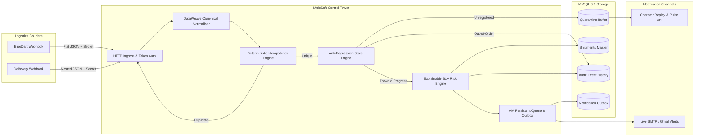

# 01 – Project Overview: Shipment Signal Control Tower

**Project Title**: Shipment Signal Control Tower — Real-Time Multi-Carrier Shipment Tracking  
**Hackathon Track**: Cognizant MuleSoft Hackathon 2026–2027 (Use Case 08: Logistics)  
**Business Domain**: Supply Chain & Logistics Integration, E-Commerce Fulfillment, Milestone Event Processing  
**Implementation Technology**: MuleSoft Anypoint Platform, Mule Runtime 4.4.0, MySQL 8.0, RAML 1.0, DataWeave 2.0  

---

## 1. The Real-World Logistics Problem

Modern enterprise supply chains and e-commerce platforms rely on multiple third-party logistics (3PL) couriers to deliver millions of packages daily. In the Indian logistics market, major providers such as **BlueDart Express** and **Delhivery Logistics** handle massive fulfillment volumes.

However, enterprises face severe integration challenges:

1. **Format Fragmentation & Heterogeneous Schemas**:
   - Every courier transmits webhook events in a proprietary JSON structure.
   - *BlueDart* pushes flat JSON payloads using keys like `awb_no`, `status_code` (`"IT"`, `"PU"`, `"OFD"`, `"DL"`), and localized timestamps (`+05:30`).
   - *Delhivery* pushes nested structures using keys like `waybill`, nested `Status.statusCode` (`"Dispatched"`, `"Van Out"`), and scan arrays.
   - Without an integration layer, consuming systems (Order Management, Customer Portals, Support Desks) must maintain custom parsing code for every carrier.

2. **Network Retries & Duplicate Events**:
   - Couriers operate over unreliable cellular connections in delivery vans and transit depots.
   - When network handshakes time out, carriers repeatedly retry sending the same scan event.
   - Without robust idempotency, duplicate events corrupt database audit trails and trigger duplicate customer notifications.

3. **Out-of-Order Delivery Scans**:
   - Courier delivery agents frequently scan packages offline or out of sequence.
   - For example, an origin pickup scan (`PICKED_UP`) might arrive after a destination sorting scan (`ARRIVED_AT_HUB`), or an `OUT_FOR_DELIVERY` scan might arrive after the customer already signed for `DELIVERED`.
   - Naive systems overwrite the current state with the latest incoming message, regressing a delivered package back to an in-transit status.

4. **Quarantine of Unmanifested Scans**:
   - Fast-moving warehouses often load and dispatch parcels before the central Warehouse Management System (WMS) finishes registering the shipment order in the database.
   - Traditional systems reject these scans with HTTP 404/500 errors, losing the tracking history entirely.

5. **Customer Alert Spam & Notification Fatigue**:
   - A single parcel can pass through 15 intermediate scanning hubs between Mumbai and Delhi.
   - If customers receive emails or SMS messages for every internal hub hop, it causes notification fatigue and escalates support costs.

---

## 2. The Solution Implemented in This Project

The **Shipment Signal Control Tower** is an enterprise-grade, event-driven MuleSoft integration application that acts as an intelligent control center between carrier webhook streams, enterprise persistence, and customer notification channels:

### Core Architectural Capabilities:
- **Canonical Normalization**: Standardizes diverse carrier payloads into an enterprise-wide Canonical Event Model (`PICKED_UP`, `IN_TRANSIT`, `ARRIVED_AT_HUB`, `OUT_FOR_DELIVERY`, `DELIVERED`, `EXCEPTION`, `RETURNED`).
- **Deterministic Deduplication**: Constructs an SHA/composite `eventKey` (`<CARRIER>-<TRACKING>-<STATUS>-<TIMESTAMP>`) and verifies it against historical records and a unique database constraint.
- **State Progression & Anti-Regression Engine**: Enforces rank-ordered lifecycle rules (`LABEL_CREATED: 10` $\rightarrow$ `PICKED_UP: 20` $\rightarrow$ `IN_TRANSIT: 30` $\rightarrow$ `ARRIVED_AT_HUB: 35` $\rightarrow$ `OUT_FOR_DELIVERY: 40` $\rightarrow$ `DELIVERED: 50`). Prevents state regression if stale events arrive.
- **Quarantine Buffer & Auto-Reconciliation**: Unmanifested shipments are saved to `pending_tracking_events` with `QUARANTINED_PENDING_REGISTRATION`. Once the shipment is registered, an automated batch reconciliation job reprocesses the quarantined events without data loss.
- **Explainable SLA Risk Engine**: Compares carrier Estimated Delivery Times (ETA) against customer Promised Delivery Dates (SLA). Dynamically classifies risk as `ON_TRACK`, `AT_RISK`, or `DELAYED`, providing human-readable explanations (`PROMISED_SLA_BREACHED`, `STALE_TRANSIT`).
- **Transactional Outbox & Milestone Queue**: Internal transit hops (`IN_TRANSIT`) are recorded quietly in audit tables without alerting customers. Only high-impact milestones (`PICKED_UP`, `OUT_FOR_DELIVERY`, `DELIVERED`, `EXCEPTION`) trigger asynchronous alerts via a transactional outbox and persistent VM queue.

---

## 3. Data Flow: Inputs, Transformations, and Outputs

### Who Sends Data?
- **Carrier Ingestion Webhooks**: Pushed automatically by courier dispatch systems (BlueDart Express, Delhivery Logistics) via HTTP POST.
- **Enterprise WMS / TMS**: E-commerce platforms register orders via `POST /api/v1/shipments`.
- **Operations & Support Personnel**: Operators query tracking, inspect risk, view carrier pulse telemetry, and trigger reconciliation batches.

### What Gets Stored?
All state is persisted in MySQL database `shipment_control_tower`:
1. **`shipments`**: Master current state of each package (latest status, status rank, estimated delivery, promised delivery, current risk level, and risk reason).
2. **`shipment_tracking_events`**: Immutable audit ledger recording every accepted scan with its original carrier status and canonical status.
3. **`pending_tracking_events`**: Quarantine holding pen for scans received before shipment registration.
4. **`notification_outbox`**: Transactional outbox table logging every customer milestone notification generated, its message body, delivery channels, and dispatch status.
5. **`integration_alerts`**: Operational table recording system-level exceptions and carrier anomalies.

---

## 4. Realistic End-to-End Shipment Example

Consider an e-commerce order from Bengaluru to Hyderabad:

1. **Order Manifestation (`LABEL_CREATED`, Rank 10)**:
   - WMS registers `DELH-11223344` with promised SLA `2026-10-14 20:00:00 UTC`.
2. **First Carrier Scan (`PICKED_UP`, Rank 20)**:
   - Delhivery sends pickup scan. Status progresses to `PICKED_UP`.
   - Milestone is eligible $\rightarrow$ Enqueued $\rightarrow$ Customer receives pickup notification email.
3. **Intermediate Hub Hops (`IN_TRANSIT`, Rank 30)**:
   - Package arrives at sorting depot.
   - Status updates in `shipments` master and audit ledger.
   - Milestone filter suppresses customer email (internal operational scan).
4. **Out for Delivery (`OUT_FOR_DELIVERY`, Rank 40)**:
   - Delivery agent scans van out. Status progresses to `OUT_FOR_DELIVERY`.
   - Milestone is eligible $\rightarrow$ Customer receives "Out for delivery today" email alert.
5. **Delivery Completion (`DELIVERED`, Rank 50)**:
   - Package delivered. Status moves to terminal state `DELIVERED`.
   - Final milestone email dispatched.
6. **Out-of-Order Recovery**:
   - If an older `IN_TRANSIT` scan from a depot delayed in cellular sync arrives *after* delivery, the engine logs an out-of-order warning, appends the scan to `shipment_tracking_events` for audit compliance, but **preserves `DELIVERED` status without regressing**.

---

## 5. Main Benefits & Measurable Outcomes

- **100% Contract Compliance**: Guaranteed by RAML 1.0 contract and Mule APIKit request validation.
- **Zero Duplicate Mutation**: Guaranteed by dual-layer deduplication (in-memory query + MySQL `UNIQUE KEY` constraint on `event_key`).
- **Zero Status Regression**: Guaranteed by numeric status rank comparison and terminal state preservation.
- **Zero Data Loss for Early Scans**: Unmanifested scans are quarantined and automatically replayed upon order registration.
- **70%+ Reduction in Customer Notification Spam**: Milestone filtering ensures customers receive notifications only on actionable lifecycle events.

---

## 6. Elevator Pitches for Interview Rehearsal

### 30-Second Elevator Pitch
> *"Our project is the Shipment Signal Control Tower, built on Mule 4. It solves the critical logistics problem of integrating fragmented multi-carrier webhooks from providers like BlueDart and Delhivery into a unified real-time tracking engine. Using MuleSoft, we normalize incoming carrier payloads into a canonical event model, enforce strict deduplication and out-of-order state regression prevention, compute explainable SLA delivery delays, and decouple customer milestone notifications using an asynchronous persistent queue and transactional outbox pattern."*

### 60-Second Elevator Pitch
> *"In enterprise e-commerce, tracking shipments across multiple courier partners is challenging due to incompatible JSON structures, duplicate webhook deliveries over unstable cellular networks, and out-of-order event arrivals that can revert a delivered package back to in-transit.*  
> *To solve this, our MuleSoft application provides a unified ingestion gateway. We use DataWeave to normalize BlueDart and Delhivery events into a canonical lifecycle model. We implement a two-tier idempotency check using deterministic event keys and database unique constraints. Our anti-regression engine uses numeric status ranks to ensure shipments only progress forward, while unmanifested parcels are safely quarantined in a pending holding table for automated batch reconciliation.*  
> *Finally, our explainable risk engine evaluates carrier ETAs against customer promised SLAs, and eligible milestone events are published to a persistent VM queue to dispatch rich HTML emails without blocking carrier webhooks."*

### 2-Minute Deep-Dive Pitch
> *(Use the structure from Section 1 through Section 4 to explain the problem, canonical model, anti-regression engine, risk assessment, and asynchronous outbox).*

---

## 7. Key Evaluator Questions Answered

### Q1: What specific problem does this project solve?
**Answer**: It solves the technical and operational challenges of ingesting multi-carrier logistics webhooks: schema incompatibility, duplicate transmissions, out-of-order scan regression, lost unmanifested scans, and customer alert spam.

### Q2: Why did you select MuleSoft for this implementation?
**Answer**: MuleSoft provides out-of-the-box capabilities perfectly tailored for this use case:
1. **APIKit Router**: Declaratively enforces the RAML 1.0 contract and handles schema validation before application logic runs.
2. **DataWeave 2.0**: Handles high-performance transformation, JSON restructuring, and date/timezone normalization across disparate carrier formats.
3. **VM Connector & Asynchronous Processing**: Allows decoupling time-critical webhook acknowledgments from slow I/O tasks like SMTP email delivery.
4. **Declarative Error Handling**: Provides centralized, robust error routing for connectivity, authentication, and validation exceptions.

### Q3: What is unique about your solution compared to standard webhook listeners?
**Answer**: Most webhook listeners simply save incoming JSON to a database. Our solution implements **enterprise-grade operational intelligence**:
1. **Deterministic Idempotency**: Prevents duplicate writes even under network retries.
2. **Anti-Regression Logic**: Prevents state downgrades if carrier events arrive out of order.
3. **Quarantine Buffer with Auto-Reconciliation**: Never drops an event just because the WMS hasn't manifested the order yet.
4. **Explainable SLA Risk Assessment**: Calculates delivery delay risks with human-readable reason codes.
5. **Transactional Outbox Pattern**: Decouples customer notifications from webhook ingestion while ensuring zero alert loss.

### Q4: What are the project's current limitations?
**Answer**: The current implementation runs as a single deployable Mule application using a local MySQL instance and local persistent VM queues. In an enterprise production deployment, we would transition the VM queues to **Anypoint MQ** for multi-worker CloudHub clustering, add **HMAC-SHA256 signature verification** for courier security, and integrate an external SMS/WhatsApp gateway.
