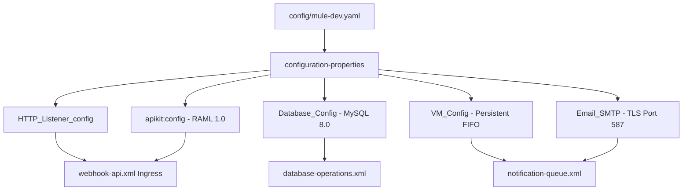

# 06 – Global Configurations & Property Hierarchies

**Project**: Shipment Signal Control Tower — Real-Time Multi-Carrier Shipment Tracking  
**Primary Configuration File**: `src/main/mule/global-config.xml`  
**Property Sources**: `src/main/resources/config/mule-dev.yaml`, `src/main/resources/config/mule-prod.yaml`  

---

## 1. Global Connectors & Configurations in `global-config.xml`

In Mule 4, all shared connector connections, thread pools, and protocol settings are declared as global configurations inside [global-config.xml](file:///c:/Users/DELL/OneDrive/Desktop/Hackathon11/Cognizant-Hackathon/Shipment-Signal-Control-Tower/src/main/mule/global-config.xml).



### 1.1 Property Source Binding
```xml
<configuration-properties doc:name="Configuration properties" doc:id="config-props" file="config/mule-dev.yaml" />
```
- **Purpose**: Dynamically loads configuration key-value pairs from `config/mule-dev.yaml` into the runtime property dictionary.

### 1.2 Global HTTP Listener Configuration (`HTTP_Listener_config`)
```xml
<http:listener-config name="HTTP_Listener_config" doc:name="HTTP Listener config" doc:id="http-listener-config">
    <http:listener-connection host="${http.host}" port="${http.port}" />
</http:listener-config>
```
- **Host**: `${http.host}` (`0.0.0.0` - binds to all local network interfaces).
- **Port**: `${http.port}` (`8081` - standard HTTP port).

### 1.3 Global Database Configuration (`Database_Config`)
```xml
<db:config name="Database_Config" doc:name="Database Config" doc:id="db-config">
    <db:my-sql-connection host="${db.host}" port="${db.port}" user="${db.user}" password="${db.password}" database="${db.database}">
        <db:connection-properties>
            <db:connection-property key="serverTimezone" value="UTC" />
            <db:connection-property key="useSSL" value="false" />
            <db:connection-property key="allowPublicKeyRetrieval" value="true" />
            <db:connection-property key="autoReconnect" value="true" />
        </db:connection-properties>
    </db:my-sql-connection>
</db:config>
```
- **Driver**: `com.mysql.cj.jdbc.Driver` (MySQL Connector/J 8.0.30).
- **Critical Connection Properties**:
  - `serverTimezone=UTC`: Guarantees all timestamp conversions occur strictly in UTC, preventing 5-hour 30-minute IST timezone drift bugs.
  - `autoReconnect=true`: Re-establishes stale connection pool sockets if MySQL recycles idle connections.
  - `allowPublicKeyRetrieval=true`: Required for MySQL 8.0 `caching_sha2_password` authentication.

### 1.4 Global Asynchronous VM Message Queue Configuration (`VM_Config`)
```xml
<vm:config name="VM_Config" doc:name="VM Config" doc:id="vm-config">
    <vm:queues>
        <vm:queue queueName="${queue.milestoneQueue}" queueType="PERSISTENT" />
        <vm:queue queueName="${queue.deadLetterQueue}" queueType="PERSISTENT" />
    </vm:queues>
</vm:config>
```
- **Queues Declared**:
  - `shipment-milestone-queue`: FIFO queue holding customer milestone alert payloads.
  - `shipment-milestone-dlq`: Dead-letter queue for permanently unprocessable alerts.
- **Queue Type**: `PERSISTENT` (messages are backed by disk storage to survive application restarts).

### 1.5 Global SMTP Email Gateway Configuration (`Email_SMTP`)
```xml
<email:smtp-config name="Email_SMTP" doc:name="Email SMTP" doc:id="email-smtp-config">
    <email:smtp-connection host="${notification.email.host}" port="${notification.email.port}" user="${notification.email.user}" password="${notification.email.password}">
        <email:properties>
            <email:property key="mail.smtp.auth" value="true" />
            <email:property key="mail.smtp.starttls.enable" value="true" />
        </email:properties>
    </email:smtp-connection>
</email:smtp-config>
```
- **Host**: `smtp.gmail.com` (or Mailtrap sandbox `sandbox.smtp.mailtrap.io`).
- **Port**: `587` with explicit `mail.smtp.starttls.enable=true` for encrypted TLS transport.

---

## 2. Complete Application Properties Table

| Property Key | Source File | What It Controls | Referenced In | Is Secret? | Local Supply Method | Production Deployment Method |
|---|---|---|---|---|---|---|
| `http.host` | `mule-dev.yaml` | Network interface binding | `global-config.xml` | No | Fixed to `0.0.0.0` | CloudHub default `0.0.0.0` |
| `http.port` | `mule-dev.yaml` | HTTP port | `global-config.xml` | No | `8081` | CloudHub dynamic `${http.port}` |
| `http.basePath` | `mule-dev.yaml` | Ingress base URL path | `mule-dev.yaml` | No | `/api/v1` | Application base path |
| `db.host` | `mule-dev.yaml` | MySQL host address | `global-config.xml` | No | `localhost` | AWS RDS or CloudHub VPC host |
| `db.port` | `mule-dev.yaml` | MySQL port | `global-config.xml` | No | `3306` | CloudHub secure property |
| `db.user` | `mule-dev.yaml` | MySQL username | `global-config.xml` | No | `root` | CloudHub secure property |
| `db.password` | `mule-dev.yaml` | MySQL password | `global-config.xml` | **YES** | `YOUR_DB_PASSWORD` | Encrypted via Anypoint Secure Properties |
| `db.database` | `mule-dev.yaml` | MySQL database name | `global-config.xml` | No | `shipment_control_tower` | CloudHub environment property |
| `carrier.bluedart.token` | `mule-dev.yaml` | BlueDart webhook shared secret | `webhook-api.xml` | **YES** | Configured secret string | Encrypted via Anypoint Secure Properties |
| `carrier.delhivery.token` | `mule-dev.yaml` | Delhivery webhook shared secret | `webhook-api.xml` | **YES** | Configured secret string | Encrypted via Anypoint Secure Properties |
| `queue.milestoneQueue` | `mule-dev.yaml` | Milestone VM queue name | `global-config.xml`, `notification-queue.xml` | No | `shipment-milestone-queue` | CloudHub / Anypoint MQ queue name |
| `queue.deadLetterQueue` | `mule-dev.yaml` | Dead Letter VM queue name | `global-config.xml` | No | `shipment-milestone-dlq` | Anypoint MQ DLQ name |
| `risk.staleTransitHours` | `mule-dev.yaml` | Stale transit hours threshold | `risk-assessment.xml` | No | `48` | Runtime environment property |
| `risk.criticalExceptionHours`| `mule-dev.yaml` | Critical SLA breach threshold | `risk-assessment.xml` | No | `24` | Runtime environment property |
| `risk.warningLeadHours` | `mule-dev.yaml` | Near-breach warning threshold | `risk-assessment.xml` | No | `6` | Runtime environment property |
| `notification.email.enabled`| `mule-dev.yaml` | Toggle for real SMTP email dispatch | `notification-queue.xml` | No | `"true"` or `"false"` | Runtime environment property |
| `notification.email.host` | `mule-dev.yaml` | SMTP host server | `global-config.xml` | No | `smtp.gmail.com` | Enterprise SMTP gateway |
| `notification.email.port` | `mule-dev.yaml` | SMTP port | `global-config.xml` | No | `587` | Enterprise SMTP port |
| `notification.email.user` | `mule-dev.yaml` | SMTP username | `global-config.xml` | **YES** | Authenticated email address | Encrypted via Anypoint Secure Properties |
| `notification.email.password`| `mule-dev.yaml` | SMTP App Password | `global-config.xml` | **YES** | 16-character App Password | Encrypted via Anypoint Secure Properties |
| `notification.email.fromAddress`| `mule-dev.yaml` | Email sender address | `notification-queue.xml` | No | Sender email address | Enterprise verified sender address |
| `notification.email.defaultRecipient`| `mule-dev.yaml` | Default recipient fallback | `notification-queue.xml` | No | Recipient inbox address | Enterprise customer notification address |
| `notification.email.subjectPrefix`| `mule-dev.yaml` | Alert email subject prefix | `notification-queue.xml` | No | `[Control Tower Alert]` | Enterprise email template prefix |

---

## 3. Property Classification & Security Hardening

1. **Ordinary Configuration**: Ports, hostnames, queue names, and risk hour thresholds (`48`, `24`, `6`). Stored as plain text in `mule-dev.yaml`.
2. **Sensitive Configuration (Secrets)**: Database passwords, carrier shared secrets, and SMTP app passwords. Stored locally in `mule-dev.yaml` during development, but **never committed to public version control**.
3. **Encrypted Secure Properties (`mule-prod.yaml`)**:
   In production, sensitive properties use the Anypoint Secure Configuration Properties extension:
   ```yaml
   db:
     password: "${secure::db.password}"
   carrier:
     bluedart:
       token: "${secure::carrier.bluedart.token}"
   ```
   At deployment time, the decryption key is passed as a JVM argument:
   `-Druntime.encryption.key=YOUR_STRONG_SECRET_KEY`

---

## 4. Why Changing a Property Requires an Application Restart

In Mule 4, property files are read **once during the initialization phase** of application deployment. Connector configurations (such as MySQL connection pools and HTTP listeners) read these values to build long-lived sockets and threads. Updating `mule-dev.yaml` on disk does not automatically mutate running connector instances; an application reload or restart is required for changes to take effect.
