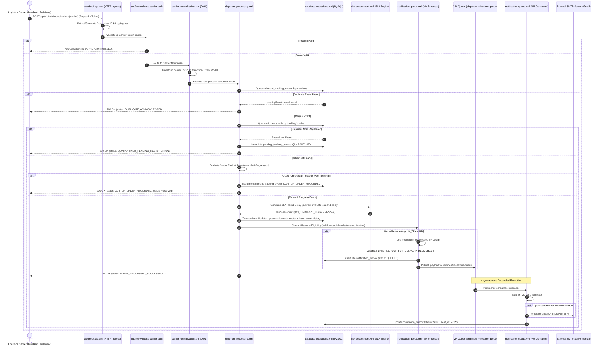

# 07 – Master Flow Execution Order & Lifecycle Sequence

**Project**: Shipment Signal Control Tower — Real-Time Multi-Carrier Shipment Tracking  
**Application**: `Shipment-Signal-Control-Tower` (Mule 4.4.0)  

---

## 1. Master End-to-End Execution Flowchart

The following diagram maps the exact step-by-step execution path of an incoming carrier webhook from HTTP ingress to database persistence, asynchronous queue publishing, and email delivery:

---

## 2. Granular Step-by-Step Execution Sequence

### Stage 1: Application Boot & Resource Initialization
1. Mule runtime loads [src/main/mule/global-config.xml](file:///c:/Users/DELL/OneDrive/Desktop/Hackathon11/Cognizant-Hackathon/Shipment-Signal-Control-Tower/src/main/mule/global-config.xml).
2. Property dictionary loads `config/mule-dev.yaml`.
3. MySQL connection pool initializes (`Database_Config`).
4. Persistent FIFO queues `shipment-milestone-queue` and DLQ initialize (`VM_Config`).
5. APIKit router compiles `api/shipment-tracking.raml` (`shipment-tracking-config`).
6. HTTP listener starts listening on `0.0.0.0:8081` (`HTTP_Listener_config`).

### Stage 2: Webhook Ingress & Distributed Tracing
- **Flow**: `shipment-tracking-main` in [webhook-api.xml](file:///c:/Users/DELL/OneDrive/Desktop/Hackathon11/Cognizant-Hackathon/Shipment-Signal-Control-Tower/src/main/mule/webhook-api.xml)
- **Component**: `<http:listener path="/api/v1/*">`
- **Action**: Extracts `X-Correlation-ID` header if provided by the client, or generates a fresh `uuid()`.
- **Log**: `[HTTP Ingress] POST /api/v1/webhooks/carriers/DELHIVERY | CorrelationId: ...`
- **Routing**: Hands request payload to `<apikit:router config-ref="shipment-tracking-config">`.

### Stage 3: Carrier Authentication & Security Gate
- **Subflow**: `subflow-validate-carrier-auth` in [webhook-api.xml](file:///c:/Users/DELL/OneDrive/Desktop/Hackathon11/Cognizant-Hackathon/Shipment-Signal-Control-Tower/src/main/mule/webhook-api.xml)
- **Component**: `<choice doc:name="Check Token Match">`
- **Action**: Reads `X-Carrier-Token` header.
- **Rule**:
  - BlueDart must match `${carrier.bluedart.token}` (`bluedart-webhook-secret-key-2026`).
  - Delhivery must match `${carrier.delhivery.token}` (`delhivery-webhook-secret-key-2026`).
- **Failure Branch**: If token is missing or incorrect, raises `APP:UNAUTHORIZED`. Central error handler catches it and returns HTTP `401 Unauthorized`.

### Stage 4: Carrier-Specific Normalization (DataWeave 2.0)
- **Subflow**: `subflow-route-carrier-normalization` in [carrier-normalization.xml](file:///c:/Users/DELL/OneDrive/Desktop/Hackathon11/Cognizant-Hackathon/Shipment-Signal-Control-Tower/src/main/mule/carrier-normalization.xml)
- **Action**: Inspects `vars.carrier` and executes:
  - BlueDart: `dw/bluedart-to-canonical.dwl`
  - Delhivery: `dw/delhivery-to-canonical.dwl`
- **Output**: Generates standardized `vars.canonicalEvent` containing normalized fields: `trackingNumber`, `carrier`, `normalizedStatus`, `eventTimestamp` (UTC), and a deterministic composite `eventKey`.

### Stage 5: Deterministic Idempotency Check (Deduplication)
- **Flow**: `flow-process-canonical-event` in [shipment-processing.xml](file:///c:/Users/DELL/OneDrive/Desktop/Hackathon11/Cognizant-Hackathon/Shipment-Signal-Control-Tower/src/main/mule/shipment-processing.xml)
- **Subflow**: `subflow-check-duplicate-event` in [database-operations.xml](file:///c:/Users/DELL/OneDrive/Desktop/Hackathon11/Cognizant-Hackathon/Shipment-Signal-Control-Tower/src/main/mule/database-operations.xml)
- **Action**: Queries MySQL `shipment_tracking_events` by `event_key = :eventKey`.
- **Duplicate Branch**: If a record exists, sets `vars.isDuplicate = true`. Skips all database updates and notifications. Immediately returns `200 OK` with `status: "DUPLICATE_ACKNOWLEDGED"`.

### Stage 6: Master Shipment Lookup
- **Subflow**: `subflow-lookup-shipment-by-tracking` in [database-operations.xml](file:///c:/Users/DELL/OneDrive/Desktop/Hackathon11/Cognizant-Hackathon/Shipment-Signal-Control-Tower/src/main/mule/database-operations.xml)
- **Action**: Queries `shipments` table by `tracking_number`.
- **Quarantine Branch**: If the shipment record is not found in master database:
  - Invokes `subflow-quarantine-unknown-shipment`.
  - Inserts raw JSON payload into `pending_tracking_events` with `processing_status = 'PENDING'`.
  - Returns `200 OK` with `status: "QUARANTINED_PENDING_REGISTRATION"`.
  - Zero data loss! Ready for automated batch reconciliation.

### Stage 7: Anti-Regression & Out-of-Order Lifecycle Validation
- **Location**: `shipment-processing.xml` lines 125–165.
- **Rules Evaluated**:
  1. `rankMap`: Maps canonical status to integer ranks:
     `LABEL_CREATED: 10`, `PICKED_UP: 20`, `IN_TRANSIT: 30`, `ARRIVED_AT_HUB: 35`, `OUT_FOR_DELIVERY: 40`, `EXCEPTION: 42`, `DELIVERY_ATTEMPTED: 45`, `DELIVERED: 50`, `RETURNED: 60`.
  2. `isOlder`: Checks if incoming scan timestamp is strictly older than `targetShipment.last_event_timestamp`.
  3. `isDowngrade`: Checks if current status is terminal (`DELIVERED` or `RETURNED`) and `newRank < currentRank`.
- **Out-of-Order Branch**:
  - If `isOutOfOrder == true`, logs warning: `[Out-of-Order] Stale/Older event received... Preserving current status without regression`.
  - Inserts the scan into `shipment_tracking_events` with `processing_result = 'OUT_OF_ORDER_RECORDED'`.
  - **Preserves master shipment status without rollback**.
  - Suppresses customer notifications. Returns `200 OK` with `status: "OUT_OF_ORDER_RECORDED"`.

### Stage 8: Explainable SLA Risk Evaluation
- **Subflow**: `subflow-evaluate-eta-and-delay` in [risk-assessment.xml](file:///c:/Users/DELL/OneDrive/Desktop/Hackathon11/Cognizant-Hackathon/Shipment-Signal-Control-Tower/src/main/mule/risk-assessment.xml)
- **Action**: Evaluates carrier ETA against promised delivery SLA:
  - If scan timestamp > promised SLA $\rightarrow$ `DELAYED` (`PROMISED_SLA_BREACHED`).
  - If last event > 48 hours ago $\rightarrow$ `AT_RISK` (`STALE_TRANSIT`).
  - If ETA > promised SLA by >24h $\rightarrow$ `DELAYED` (`CRITICAL_DELAY`).
  - If ETA > promised SLA by >6h $\rightarrow$ `AT_RISK` (`SLA_BREACH_WARNING`).
  - Otherwise $\rightarrow$ `ON_TRACK`.

### Stage 9: Durable Transactional Persistence
- **Subflow**: `subflow-update-shipment-status-and-event` in [database-operations.xml](file:///c:/Users/DELL/OneDrive/Desktop/Hackathon11/Cognizant-Hackathon/Shipment-Signal-Control-Tower/src/main/mule/database-operations.xml)
- **Action**: Updates `shipments` master table (`current_status`, `status_rank`, `last_event_timestamp`, `risk_level`, `risk_reason`) AND inserts into `shipment_tracking_events` with `processing_result = 'PROCESSED'`.

### Stage 10: Milestone Notification Publishing (Transactional Outbox)
- **Subflow**: `subflow-publish-milestone-notification` in [notification-queue.xml](file:///c:/Users/DELL/OneDrive/Desktop/Hackathon11/Cognizant-Hackathon/Shipment-Signal-Control-Tower/src/main/mule/notification-queue.xml)
- **Milestone Filter**: Checks if `normalizedStatus` is one of `['PICKED_UP', 'OUT_FOR_DELIVERY', 'DELIVERED', 'EXCEPTION', 'DELIVERY_ATTEMPTED']`.
- **Suppression Branch**: Routine scans (`IN_TRANSIT`, `ARRIVED_AT_HUB`) log `[CUSTOMER NOTIFICATION SUPPRESSED (BY DESIGN)]` and skip alert generation.
- **Eligible Branch**:
  1. Inserts record into `notification_outbox` table with `status = 'QUEUED'`.
  2. Executes `<vm:publish config-ref="VM_Config" queueName="shipment-milestone-queue">`.
  3. Returns `200 OK` acknowledgment to the courier in `<50ms`.

### Stage 11: Asynchronous Queue Consumption & Email Dispatch
- **Flow**: `flow-consume-milestone-notification` in [notification-queue.xml](file:///c:/Users/DELL/OneDrive/Desktop/Hackathon11/Cognizant-Hackathon/Shipment-Signal-Control-Tower/src/main/mule/notification-queue.xml)
- **Component**: `<vm:listener queueName="shipment-milestone-queue">`
- **Action**: Runs in a background thread.
- **Processing**:
  1. Builds styled HTML email card with status badge and tracking details table.
  2. If `notification.email.enabled == "true"`, transmits physical email via `email:send` (Gmail/Mailtrap SMTP port 587 with STARTTLS).
  3. If disabled, logs full email simulation in Studio console.
  4. Calls `subflow-mark-notification-sent` to update `notification_outbox` status to `'SENT'` and `sent_at = NOW()`.
