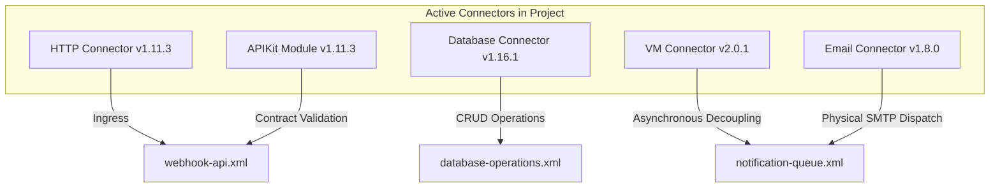

# 09 – Connector & Module Technical Reference

**Project**: Shipment Signal Control Tower — Real-Time Multi-Carrier Shipment Tracking  
**Application Runtime**: Mule Runtime 4.4.0 EE  

---

## 1. Fundamentals: Connector vs. Operation vs. Global Configuration

In Mule 4, integration capabilities are structured in three distinct conceptual layers:

1. **Global Configuration**: A shared XML element declaring connection parameters, socket timeouts, authentication credentials, and connection pools (e.g., `<http:listener-config>`, `<db:config>`). It initializes long-lived resources once during runtime boot.
2. **Connector**: A packaged Mule plugin providing protocol or system integration (e.g., `mule-http-connector`, `mule-db-connector`, `mule-vm-connector`).
3. **Connector Operation**: A specific message processor executing a discrete protocol action within a flow (e.g., `<http:listener>`, `<db:select>`, `<db:insert>`, `<vm:publish>`).

---

## 2. Complete Inventory of Connectors Used in This Project

---

### 2.1 HTTP Connector (`mule-http-connector:1.11.3`)

- **What It Is**: Provides enterprise HTTP/HTTPS listener and requestor capabilities.
- **Why Used Here**: Exposes RESTful webhook endpoints to receive JSON data from couriers and clients.
- **Global Configuration Name**: `HTTP_Listener_config`
- **Operations Used**: `<http:listener>`
- **Key Parameters**:
  - `host="${http.host}"` (`0.0.0.0`)
  - `port="${http.port}"` (`8081`)
  - `path="/api/v1/*"` (main router) and `/console/*` (APIKit console)
- **Timeouts & Sockets**: Inherits default HTTP 1.1 non-blocking selector pools with 30-second socket timeouts.
- **Common Failures**: Port 8081 already in use (`Address already in use: JVM_Bind`), malformed HTTP request headers.
- **Handled In**: Catches port conflicts during boot (fatal deployment exception); handles runtime request timeouts via `globalError_Handler`.

---

### 2.2 APIKit Module (`mule-apikit-module:1.11.3`)

- **What It Is**: An architectural routing and governance module based on RAML specifications. *(Note: Not a transport connector; it operates as an in-memory routing and validation engine).*
- **Why Used Here**: Automatically enforces contract-first API design, validating incoming headers, query parameters, URI parameters, and body payloads against `api/shipment-tracking.raml`.
- **Global Configuration Name**: `shipment-tracking-config`
- **Operations Used**:
  - `<apikit:router>`: Evaluates incoming requests and dispatches them to matching flow definitions.
  - `<apikit:console>`: Renders an interactive browser console for API exploration.
- **Common Failures**:
  - `APIKIT:BAD_REQUEST`: Client sends JSON missing required RAML properties.
  - `APIKIT:NOT_FOUND`: Client requests an undefined URL path.
  - `APIKIT:METHOD_NOT_ALLOWED`: Client invokes `DELETE` on a read-only endpoint.
- **Handled In**: Caught by `globalError_Handler` in `error-handling.xml` and mapped to corresponding HTTP error envelopes.

---

### 2.3 Database Connector (`mule-db-connector:1.16.1`)

- **What It Is**: Provides standard JDBC connection pooling and parameterized SQL query execution.
- **Why Used Here**: Connects to the MySQL 8.0 `shipment_control_tower` database to perform ACID-compliant CRUD operations.
- **Global Configuration Name**: `Database_Config`
- **Operations Used**:
  - `<db:select>`: Queries duplicate events, shipment master state, event history, pending quarantine records, and pulse metrics.
  - `<db:insert>`: Inserts new shipments, appends audit events, quarantines unmanifested parcels, and logs outbox records.
  - `<db:update>`: Mutates shipment current status and updates outbox records from `QUEUED` to `SENT`.
- **Key Parameters**:
  - `serverTimezone=UTC` (prevents timezone skew).
  - `allowPublicKeyRetrieval=true` (MySQL 8.0 auth compatibility).
  - `autoReconnect=true` (recycles dropped database sockets).
- **Common Failures**: `DB:CONNECTIVITY` (MySQL service stopped), `DB:BAD_SQL_SYNTAX`, duplicate key violation on `event_key`.
- **Handled In**: Mapped to HTTP 503 Service Unavailable or HTTP 500 in `globalError_Handler`.

---

### 2.4 VM Connector (`mule-vm-connector:2.0.1`)

- **What It Is**: An intra-JVM asynchronous messaging broker providing persistent FIFO queues.
- **Why Used Here**: Decouples time-critical webhook ingestion from slow notification dispatch (SMTP emails). Allows webhook requests to acknowledge couriers in `<50ms`.
- **Global Configuration Name**: `VM_Config`
- **Queues Configured**:
  - `shipment-milestone-queue` (`PERSISTENT`)
  - `shipment-milestone-dlq` (`PERSISTENT`)
- **Operations Used**:
  - `<vm:publish>`: Enqueues milestone notification payloads.
  - `<vm:listener>`: Asynchronously consumes enqueued payloads.
- **Failure Handling**: If the consumer fails repeatedly, unrecoverable messages are routed to the Dead Letter Queue (`shipment-milestone-dlq`).
- **CloudHub Alternative**: In a multi-worker CloudHub cluster, replacing `mule-vm-connector` with **Anypoint MQ** (`anypoint-mq-connector:3.x`) provides cross-worker distributed messaging without altering outbox or business logic.

---

### 2.5 Email Connector (`mule-email-connector:1.8.0`)

- **What It Is**: Enterprise JavaMail wrapper supporting SMTP, IMAP, and POP3.
- **Why Used Here**: Dispatches rich HTML milestone notification emails to customer inboxes.
- **Global Configuration Name**: `Email_SMTP`
- **Operations Used**: `<email:send>`
- **Key Parameters**:
  - `host="${notification.email.host}"` (`smtp.gmail.com` or `sandbox.smtp.mailtrap.io`)
  - `port="587"`
  - `mail.smtp.auth=true`
  - `mail.smtp.starttls.enable=true` (encrypted transport)
- **Failure Handling**: Wrapped inside `<try>` with `<on-error-continue>`. If external SMTP servers are unreachable or reject authentication, the error is logged as a warning and the application does not crash.
