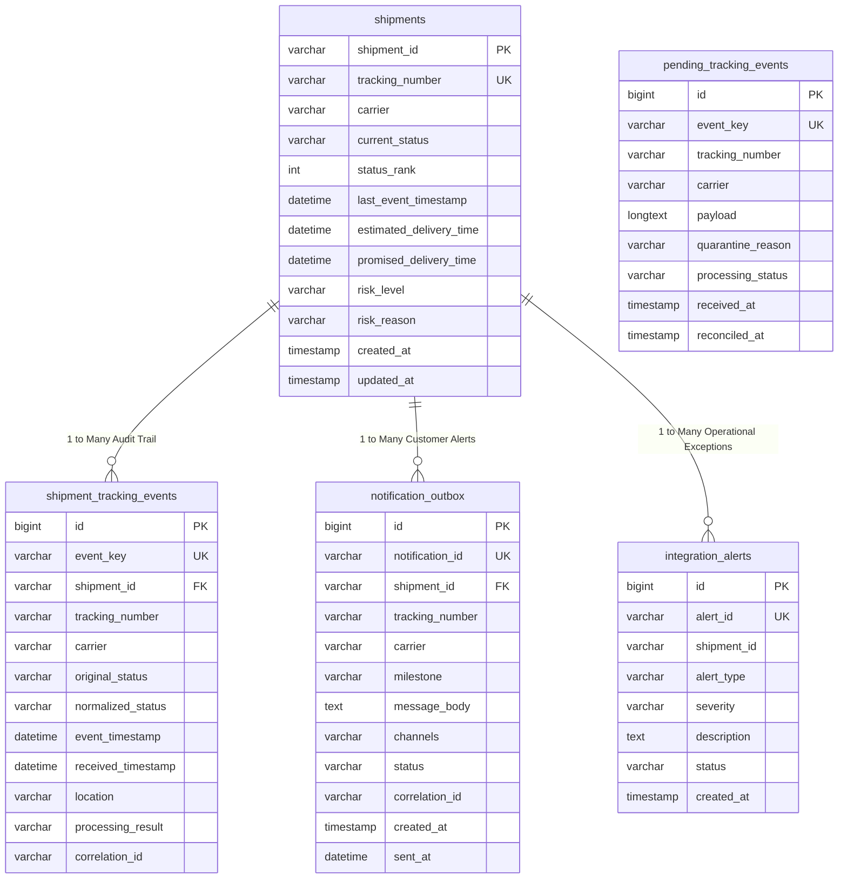

# 11 – Database Schema, SQL Operations & ACID Transactions

**Database Engine**: MySQL Server 8.0 (InnoDB Storage Engine)  
**Database Name**: `shipment_control_tower`  
**DDL Script**: `database/schema.sql`  
**Seed Script**: `database/sample-data.sql`  
**Verification Script**: `database/verification-queries.sql`  

---

## 1. Entity-Relationship Data Model

The database enforces a clean separation of concerns across 5 relational tables:



---

## 2. Deep-Dive Table Specifications

### Table 1: `shipments` (Master State Record)
- **Purpose**: Stores the **latest forward-progressed state**, current status rank, and SLA timestamps for registered shipments.
- **Primary Key**: `shipment_id` (`VARCHAR(50)`).
- **Unique Constraint**: `UNIQUE KEY uq_shipments_tracking_number (tracking_number)`.
- **Key Columns**:
  - `current_status`: Current lifecycle phase (`LABEL_CREATED`, `PICKED_UP`, `IN_TRANSIT`, `OUT_FOR_DELIVERY`, `DELIVERED`).
  - `status_rank`: Integer rank used for anti-regression checks (`10` to `60`).
  - `risk_level`: Current risk computed by Risk Engine (`ON_TRACK`, `AT_RISK`, `DELAYED`).
  - `promised_delivery_time`: Promised customer SLA used as the baseline for delay calculations.
- **Modified By**:
  - `post:\shipments...`: Inserts initial manifested shipment record (`LABEL_CREATED`, Rank 10).
  - `subflow-update-shipment-status-and-event`: Updates `current_status`, `status_rank`, `last_event_timestamp`, and `risk_level` on forward progression.

---

### Table 2: `shipment_tracking_events` (Immutable Audit Ledger)
- **Purpose**: Append-only audit log of every valid or out-of-order tracking scan accepted by the system.
- **Primary Key**: `id` (`BIGINT AUTO_INCREMENT`).
- **Unique Constraint**: `UNIQUE KEY uq_event_key (event_key)`.
- **Deduplication Mechanism**: If a courier retries the same scan, MySQL immediately blocks insertion via the `event_key` unique index.
- **Key Columns**:
  - `event_key`: Deterministic composite key (`<CARRIER>-<AWB>-<STATUS>-<TIMESTAMP>`).
  - `original_status`: Raw carrier status code (`IT`, `OFD`, `DL`).
  - `normalized_status`: Canonical status (`IN_TRANSIT`, `OUT_FOR_DELIVERY`, `DELIVERED`).
  - `processing_result`: Result enum (`PROCESSED`, `OUT_OF_ORDER_RECORDED`).

---

### Table 3: `pending_tracking_events` (Quarantine Holding Buffer)
- **Purpose**: Safety buffer holding scans received for parcels that have not yet been registered in the `shipments` master table.
- **Primary Key**: `id` (`BIGINT AUTO_INCREMENT`).
- **Unique Constraint**: `UNIQUE KEY uq_pending_event_key (event_key)`.
- **Key Columns**:
  - `payload`: Exact raw JSON received from the carrier courier.
  - `processing_status`: Lifecycle state (`PENDING`, `RECONCILED`, `FAILED`).
- **Reconciliation Lifecycle**:
  - When WMS registers the shipment via `POST /shipments`, an operator or scheduler calls `POST /events/reconcile`.
  - The reconciler parses stored `payload`, passes it through normalizers, updates master state, and updates `processing_status = 'RECONCILED'`.

---

### Table 4: `notification_outbox` (Transactional Outbox Pattern)
- **Purpose**: Guarantees at-least-once alert delivery by saving customer milestone messages to the database before pushing to the message queue.
- **Primary Key**: `id` (`BIGINT AUTO_INCREMENT`).
- **Unique Constraint**: `UNIQUE KEY uq_notification_id (notification_id)`.
- **Key Columns**:
  - `milestone`: Target milestone event (`PICKED_UP`, `OUT_FOR_DELIVERY`, `DELIVERED`).
  - `status`: Delivery status (`QUEUED` $\rightarrow$ updated to `SENT` after SMTP dispatch).
  - `sent_at`: Timestamp recording physical dispatch.

---

### Table 5: `integration_alerts` (Operational Anomaly Table)
- **Purpose**: Logs operational exceptions, severe delivery SLA breaches, and unmapped carrier codes for monitoring dashboards.

---

## 3. Transactional Consistency & ACID Updates

When an eligible milestone scan (e.g., `OUT_FOR_DELIVERY`) arrives, the application must update the master status **and** append to the audit ledger atomically.

In [database-operations.xml](file:///c:/Users/DELL/OneDrive/Desktop/Hackathon11/Cognizant-Hackathon/Shipment-Signal-Control-Tower/src/main/mule/database-operations.xml) (`subflow-update-shipment-status-and-event`), the operations run under transaction management:

```sql
-- 1. Master Update
UPDATE shipments 
SET current_status = :newStatus,
    status_rank = :newRank,
    last_event_timestamp = :eventTimestamp,
    estimated_delivery_time = :eta,
    risk_level = :riskLevel,
    risk_reason = :riskReason
WHERE shipment_id = :shipmentId;

-- 2. Event Ledger Insert
INSERT INTO shipment_tracking_events (
    event_key, shipment_id, tracking_number, carrier, original_status, 
    normalized_status, event_timestamp, location, processing_result, correlation_id
) VALUES (
    :eventKey, :shipmentId, :trackingNumber, :carrier, :originalStatus,
    :normalizedStatus, :eventTimestamp, :location, 'PROCESSED', :correlationId
);
```

If the audit insert fails (e.g., unexpected constraint violation), the master update is rolled back, guaranteeing the database never displays a status without its supporting audit scan.

---

## 4. Safe Verification SQL Queries for Evaluator Demos

Run these non-destructive queries in MySQL Workbench during your live evaluation demo:

```sql
USE shipment_control_tower;

-- 1. Verify Current Master Status & Risk Levels
SELECT shipment_id, tracking_number, carrier, current_status, status_rank, 
       last_event_timestamp, risk_level, risk_reason 
FROM shipments 
ORDER BY shipment_id ASC;

-- 2. Inspect Chronological Audit Event History
SELECT id, event_key, tracking_number, carrier, normalized_status, 
       event_timestamp, processing_result 
FROM shipment_tracking_events 
ORDER BY id DESC LIMIT 10;

-- 3. Verify Transactional Outbox Email Alerts
SELECT notification_id, tracking_number, milestone, status, created_at, sent_at 
FROM notification_outbox 
ORDER BY id DESC LIMIT 5;

-- 4. Check Quarantined Unregistered Scans
SELECT id, event_key, tracking_number, carrier, processing_status, received_at 
FROM pending_tracking_events;
```
