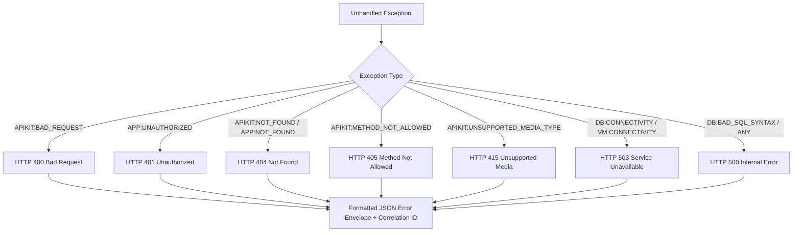

# 14 – Centralized Error Handling, Resilience & Failure Recovery

**Project**: Shipment Signal Control Tower — Real-Time Multi-Carrier Shipment Tracking  
**Central Handler File**: `src/main/mule/error-handling.xml` (`globalError_Handler`)  
**Application Runtime**: Mule Runtime 4.4.0 EE  

---

## 1. Centralized Error Handling Architecture

In Mule 4, unhandled exceptions bubble up the call stack until intercepted by an error handler.

The **Shipment Signal Control Tower** enforces a centralized error-handling strategy:
- All API ingress flows in [webhook-api.xml](file:///c:/Users/DELL/OneDrive/Desktop/Hackathon11/Cognizant-Hackathon/Shipment-Signal-Control-Tower/src/main/mule/webhook-api.xml) bind to `globalError_Handler`.
- Exceptions are mapped to specific HTTP status codes.
- Responses are formatted into a consistent, machine-readable JSON error schema.
- Internal stack traces and database credentials are completely shielded from external clients.



---

## 2. Complete Inventory of Error Handlers

| Error Type Handled | HTTP Status | Error Code Enum | Typical Cause | Database & Queue Side Effect | Retry Safe? |
|---|---|---|---|---|---|
| `APIKIT:BAD_REQUEST` | `400` | `BAD_REQUEST` | Malformed JSON syntax or missing required RAML field. | Zero database mutation. Zero messages published. | **No**: Client must fix JSON body before retrying. |
| `APP:UNAUTHORIZED` | `401` | `UNAUTHORIZED` | Invalid or missing `X-Carrier-Token` header. | Zero database mutation. Flow halts immediately. | **No**: Client must provide valid shared secret. |
| `APIKIT:NOT_FOUND`<br>`APP:NOT_FOUND` | `404` | `RESOURCE_NOT_FOUND` | Tracking number does not exist on `GET /shipments/{id}` or URL path invalid. | Read query returned 0 rows. No state change. | **No**: Client must query a valid tracking number. |
| `APIKIT:METHOD_NOT_ALLOWED` | `405` | `METHOD_NOT_ALLOWED` | Executing `PUT` or `DELETE` on a read-only endpoint. | Zero database mutation. | **No**: Client must use supported HTTP method. |
| `APIKIT:UNSUPPORTED_MEDIA_TYPE` | `415` | `UNSUPPORTED_MEDIA_TYPE` | Sending `application/xml` instead of `application/json`. | Zero database mutation. | **No**: Client must set `Content-Type: application/json`. |
| `DB:CONNECTIVITY`<br>`DB:RETRY_EXHAUSTED` | `503` | `DATABASE_UNAVAILABLE` | MySQL database down or connection pool exhausted. | Transaction rolled back cleanly. Webhook NOT acknowledged as processed. | **YES**: Courier should retry; idempotency will protect on recovery. |
| `VM:CONNECTIVITY`<br>`VM:RETRY_EXHAUSTED` | `503` | `QUEUE_UNAVAILABLE` | In-memory/persistent VM queue disk full or broker stopped. | Master update committed; outbox remains in `QUEUED` state. | **YES**: Re-enqueuer will pick up unprocessed outbox rows. |
| `DB:BAD_SQL_SYNTAX`<br>`DB:QUERY_EXECUTION` | `500` | `DATABASE_ERROR` | Schema mismatch or SQL execution failure. | Transaction rolled back by MySQL engine. | **No**: Requires engineer code review. |
| `ANY` (Default Fallback) | `500` | `INTERNAL_SERVER_ERROR` | Unforeseen runtime exception. | Transaction safely aborted. Client receives correlation ID. | **Conditional**: Depends on root cause. |

---

## 3. On Error Propagate vs. On Error Continue (Real Code Comparison)

### When `On Error Propagate` Is Used:
In `error-handling.xml` (`globalError_Handler`), all branches use `<on-error-propagate>`:
```xml
<on-error-propagate type="APIKIT:BAD_REQUEST" enableNotifications="true" logException="true">
    <set-variable variableName="httpStatus" value="400" />
    <ee:transform doc:name="Build 400 Error Response">...</ee:transform>
</on-error-propagate>
```
- **Why**: Propagating the error stops the current flow execution, triggers the HTTP Listener's `<http:error-response>`, and transmits the `400` status code back to the client.

### When `On Error Continue` Is Used:
In `notification-queue.xml` (`try-send-email`), the live SMTP send processor is wrapped in a `<try>` scope with `<on-error-continue>`:
```xml
<try doc:name="Try Physical Email Dispatch">
    <email:send doc:name="Send Live Email Notification" ... />
    <error-handler>
        <on-error-continue enableNotifications="true" logException="true" doc:name="Handle SMTP Error Gracefully">
            <logger level="WARN" message="[Live Email Warning] Could not connect to external SMTP server... Event recorded in outbox." />
        </on-error-continue>
    </error-handler>
</try>
```
- **Why**: Email dispatch is a non-critical downstream operation. If Gmail or Mailtrap is unreachable due to internet disruption, `<on-error-continue>` swallows the SMTP error so the VM consumer does **not** crash and the outbox status can still be audited cleanly.

---

## 4. Why We Never Falsely Acknowledge Webhooks

> [!IMPORTANT]
> **Core Architectural Principle**:  
> If an infrastructure failure occurs (e.g., MySQL crashes during an update), the application **never returns HTTP 200 OK**. It throws a `503 Service Unavailable`.  
> If an API falsely returns `200 OK` before an event is durably committed to the database, the courier assumes the package status was accepted and will never retransmit. If the event is lost, the control tower's tracking data is permanently out of sync. Returning `503` informs the carrier to safely re-deliver the webhook later!
