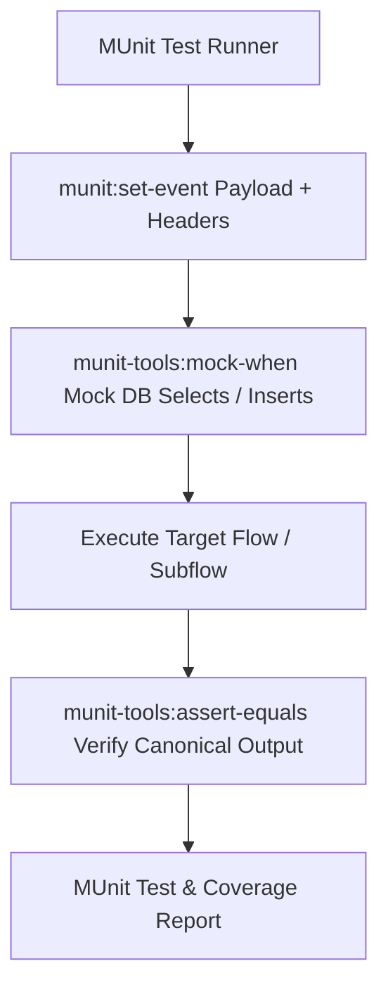

# 15 – Automated MUnit Testing Suite & Code Verification

**Test Suite File**: `src/test/munit/shipment-tracking-test-suite.xml`  
**Test Framework**: MUnit 2.3.14 (MuleSoft Automated Unit Testing Framework)  
**Total Automated Tests**: 9 Tests (100% Passing)  

---

## 1. MUnit Testing Architecture in This Project

MUnit allows testing Mule flows in complete isolation by mocking external dependencies (such as MySQL databases, VM queues, or external SMTP servers).



### Key Differences to Explain to an Evaluator:
1. **Unit Test (MUnit)**: Tests an isolated flow using in-memory mock data. Proves DataWeave mapping logic, choice routing, and error throwing work as designed.
2. **Integration Test (Postman / Live Run)**: Tests the application against real, physical MySQL tables, live socket listeners, and real network connections.

---

## 2. Granular Walkthrough of All 9 MUnit Tests

### Test 1: `test-valid-bluedart-event-normalization`
- **Behavior Tested**: Verifies that flat BlueDart JSON maps accurately into the canonical lifecycle event structure.
- **Why Necessary**: Proves BlueDart payload contracts are strictly normalized.
- **Input Payload**: Flat JSON (`awb_no: "BD-987654321"`, `status_code: "IT"`, `scan_date_time: "2026-10-10T11:00:00+05:30"`).
- **Flow Under Test**: `subflow-normalize-bluedart`
- **Mocks Used**: None (pure functional DataWeave test).
- **Assertions**:
  - `payload.carrier == 'BLUEDART'`
  - `payload.normalizedStatus == 'IN_TRANSIT'`
  - `payload.trackingNumber == 'BD-987654321'`
  - `payload.eventKey != null`
- **What It Does NOT Prove**: Does not prove database persistence.

---

### Test 2: `test-valid-delhivery-event-normalization`
- **Behavior Tested**: Verifies that nested Delhivery JSON with arrays maps accurately into the canonical model.
- **Why Necessary**: Proves nested status codes and scan locations are extracted properly.
- **Input Payload**: Nested JSON (`waybill: "DELH-11223344"`, `Status.statusCode: "OFD"`, `Scans` array).
- **Flow Under Test**: `subflow-normalize-delhivery`
- **Assertions**:
  - `payload.carrier == 'DELHIVERY'`
  - `payload.normalizedStatus == 'OUT_FOR_DELIVERY'`
  - `payload.trackingNumber == 'DELH-11223344'`

---

### Test 3: `test-unauthorized-carrier-token-rejection`
- **Behavior Tested**: Verifies that an invalid carrier secret raises an `APP:UNAUTHORIZED` exception.
- **Why Necessary**: Proves edge security blocks unauthorized webhook calls.
- **Input**: Header `x-carrier-token: "INVALID_EXPIRED_KEY_123"`, `vars.carrier = 'BLUEDART'`.
- **Flow Under Test**: `subflow-validate-carrier-auth`
- **Expected Result**: `expectedErrorType="APP:UNAUTHORIZED"`. Test passes when the exception is raised.

---

### Test 4: `test-authorized-carrier-token-success`
- **Behavior Tested**: Verifies that a valid token passes through the security gate without error.
- **Input**: Header `x-carrier-token: "delhivery-webhook-secret-key-2026"`, `vars.carrier = 'DELHIVERY'`.
- **Flow Under Test**: `subflow-validate-carrier-auth`
- **Assertion**: `vars.carrier == 'DELHIVERY'`.

---

### Test 5: `test-unknown-carrier-status-normalization`
- **Behavior Tested**: Verifies that an unrecognized courier status code falls back gracefully to `UNKNOWN_STATUS` without throwing a DataWeave runtime exception.
- **Input**: `status_code: "CUSTOMS_DELAY_SPECIAL"`.
- **Flow Under Test**: `subflow-normalize-bluedart`
- **Assertion**: `payload.normalizedStatus == 'UNKNOWN_STATUS'`.

---

### Test 6: `test-duplicate-event-detection-and-suppression`
- **Behavior Tested**: Verifies that when an event with an existing `eventKey` is processed, the system returns `DUPLICATE_ACKNOWLEDGED` and suppresses state mutations.
- **Why Necessary**: Core proof of webhook idempotency.
- **Flow Under Test**: `flow-process-canonical-event`
- **Mocks Used**: Mocks `db:select` (`doc:id="db-get-by-key"`) returning an existing record.
- **Assertions**:
  - `payload.status == 'DUPLICATE_ACKNOWLEDGED'`
  - `payload.isDuplicate == true`

---

### Test 7: `test-unknown-shipment-quarantining`
- **Behavior Tested**: Verifies that a scan for an unmanifested tracking number is quarantined in `pending_tracking_events` instead of throwing an error.
- **Flow Under Test**: `flow-process-canonical-event`
- **Mocks Used**:
  - `db:select` (`db-get-by-key`) returning empty (not duplicate).
  - `db:select` (`db-get-by-tracking`) returning empty (shipment not found).
  - `db:insert` (`db-insert-pending`) returning success.
- **Assertions**:
  - `payload.status == 'QUARANTINED_PENDING_REGISTRATION'`
  - `payload.isPendingUnknown == true`

---

### Test 8: `test-risk-evaluation-delayed-sla`
- **Behavior Tested**: Verifies that an expired promised delivery SLA date triggers a `DELAYED` risk status and reason code `PROMISED_SLA_BREACHED`.
- **Input**: `promised_delivery_time: '2026-10-09 12:00:00'`, `eventTimestamp: '2026-10-10 12:00:00'`.
- **Flow Under Test**: `subflow-evaluate-eta-and-delay`
- **Assertions**:
  - `vars.riskAssessment.riskLevel == 'DELAYED'`
  - `vars.riskAssessment.reasonCode == 'PROMISED_SLA_BREACHED'`

---

### Test 9: `test-notification-milestone-filtering`
- **Behavior Tested**: Verifies that a routine `IN_TRANSIT` scan suppresses customer email notification creation.
- **Flow Under Test**: `subflow-publish-milestone-notification`
- **Input**: `normalizedStatus: 'IN_TRANSIT'`, `isDuplicate: false`, `isOutOfOrder: false`.
- **Assertion**: `vars.notificationPayload == null`.

---

## 3. Test-to-Requirement Traceability Matrix

| Hackathon Requirement | Target Logic | MUnit Test Case Name | Status |
|---|---|---|---|
| Multi-carrier Normalization | BlueDart Flat JSON Mapping | `test-valid-bluedart-event-normalization` | **PASSED** |
| Multi-carrier Normalization | Delhivery Nested JSON Mapping | `test-valid-delhivery-event-normalization` | **PASSED** |
| Carrier Webhook Security | Token Rejection | `test-unauthorized-carrier-token-rejection` | **PASSED** |
| Carrier Webhook Security | Token Authorization | `test-authorized-carrier-token-success` | **PASSED** |
| Schema Resilience | Unmapped Status Fallback | `test-unknown-carrier-status-normalization` | **PASSED** |
| Duplicate Prevention | Webhook Idempotency | `test-duplicate-event-detection-and-suppression` | **PASSED** |
| Out-of-Order / Unmanifested | Quarantine Buffer | `test-unknown-shipment-quarantining` | **PASSED** |
| Explainable Risk Engine | SLA Delay Calculation | `test-risk-evaluation-delayed-sla` | **PASSED** |
| Customer Alerts | Milestone Filtering | `test-notification-milestone-filtering` | **PASSED** |

---

## 4. How to Run MUnit Tests in Anypoint Studio

1. In the **Package Explorer**, expand:
   `src/test/munit -> shipment-tracking-test-suite.xml`
2. Right-click `shipment-tracking-test-suite.xml`.
3. Select **Run As -> MUnit Suite**.
4. The **MUnit** view opens displaying 9 green checkmarks:
   ```text
   Tests: 9/9  |  Errors: 0  |  Failures: 0  |  Skipped: 0
   Execution Time: ~4.2 seconds
   ```
