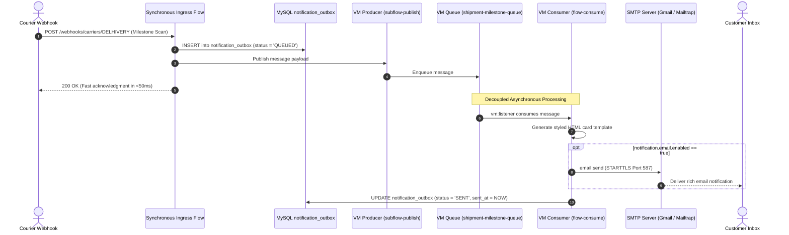

# 18 – Asynchronous Messaging & Notification Processing

**Project**: Shipment Signal Control Tower — Real-Time Multi-Carrier Shipment Tracking  
**Messaging Module**: Mule VM Connector (`mule-vm-connector:2.0.1`)  
**Design Pattern**: Transactional Outbox Pattern + Asynchronous Message Queue  
**Outbox Table**: MySQL `notification_outbox`  

---

## 1. Messaging Architecture & Outbox Pattern

To achieve high throughput and fault tolerance, customer notifications are decoupled from the synchronous HTTP webhook pipeline using the **Transactional Outbox Pattern**:



---

## 2. Four Discrete Lifecycle Stages Explained

An evaluator will expect you to clearly differentiate these four stages:

1. **Accepting a Webhook**: Receiving the raw HTTP POST request, validating `X-Carrier-Token`, and extracting the correlation ID.
2. **Storing an Event**: Normalizing the payload and atomically committing the record to `shipments` and `shipment_tracking_events` in MySQL.
3. **Publishing a Message**: Writing the alert intent to `notification_outbox` (`QUEUED`) and enqueueing the payload onto `shipment-milestone-queue`.
4. **Delivering a Notification**: The asynchronous consumer dequeuing the message, building the HTML template, transmitting it via SMTP, and updating the outbox to `SENT`.

---

## 3. Milestone Notification Filtering (Anti-Spam Filter)

A typical package might generate 15 internal transit scans between pickup and delivery. Alerting customers on every intermediate sorting facility creates notification fatigue and inflates operational SMS/email costs.

In [src/main/mule/notification-queue.xml](file:///c:/Users/DELL/OneDrive/Desktop/Hackathon11/Cognizant-Hackathon/Shipment-Signal-Control-Tower/src/main/mule/notification-queue.xml), the **Milestone Filter** evaluates:

```xml
<when expression="#[(['PICKED_UP', 'OUT_FOR_DELIVERY', 'DELIVERED', 'EXCEPTION', 'DELIVERY_ATTEMPTED'] contains vars.canonicalEvent.normalizedStatus) and (vars.isDuplicate == false) and (vars.isOutOfOrder == false) and (vars.isPendingUnknown == false)]">
```

### Event Classification:
- **Eligible Milestones (Customer Alerts Triggered)**:
  - `PICKED_UP`: Initial carrier custody transfer.
  - `OUT_FOR_DELIVERY`: Same-day delivery notification.
  - `DELIVERED`: Delivery confirmation.
  - `EXCEPTION`: Operational delay or transit disruption.
  - `DELIVERY_ATTEMPTED`: Failed delivery attempt requiring customer awareness.
- **Suppressed Events (Zero Customer Alerts)**:
  - `IN_TRANSIT`: Internal freight hub movement.
  - `ARRIVED_AT_HUB`: Depot arrival scan.
  - `LABEL_CREATED`: Initial manifestation before physical package receipt.
  - Any duplicate or out-of-order scans.

---

## 4. Asynchronous Queue Consumer & HTML Rendering

The consumer flow `flow-consume-milestone-notification` is driven by:
```xml
<vm:listener doc:name="Listen on Milestone Queue" config-ref="VM_Config" 
    queueName="${queue.milestoneQueue}" numberOfConsumers="1" />
```

### Processing Steps:
1. **Dynamic Message Templates**:
   - `PICKED_UP`: *"Good news! Your shipment has been picked up by the courier partner and is on its way."*
   - `OUT_FOR_DELIVERY`: *"Out for delivery! Your package is with our delivery agent and will arrive today."*
   - `DELIVERED`: *"Delivered successfully! Your shipment has been delivered at destination."*
2. **HTML Email Construction**: Generates a responsive HTML card containing an executive header, green milestone badge, structured table (Tracking #, Carrier, Current Location, Timestamp), and footer.
3. **Toggleable Physical Dispatch**:
   - If `notification.email.enabled == "true"`: Dispatches live SMTP email via `email:send` (Gmail port 587 with STARTTLS).
   - If `notification.email.enabled == "false"`: Outputs full email notification layout to Anypoint Studio console log, ensuring zero runtime failures during offline demonstrations.
4. **Outbox State Update**: Calls `subflow-mark-notification-sent` to update MySQL record to `SENT`.

---

## 5. VM Queues vs. Anypoint MQ (CloudHub Evolution)

| Feature | Local Implementation (`mule-vm-connector`) | CloudHub Production (`anypoint-mq-connector`) |
|---|---|---|
| **Broker Location** | Intra-JVM (Local developer workstation). | Multi-tenant AWS distributed messaging service. |
| **Persistence** | Persistent disk storage on local host. | Multi-Availability-Zone distributed replication. |
| **Clustering** | Local single worker only. | Accessible across all CloudHub worker replicas. |
| **Outbox Code Changes** | N/A | **Zero changes**: Outbox table and milestone filter logic remain 100% identical. |
