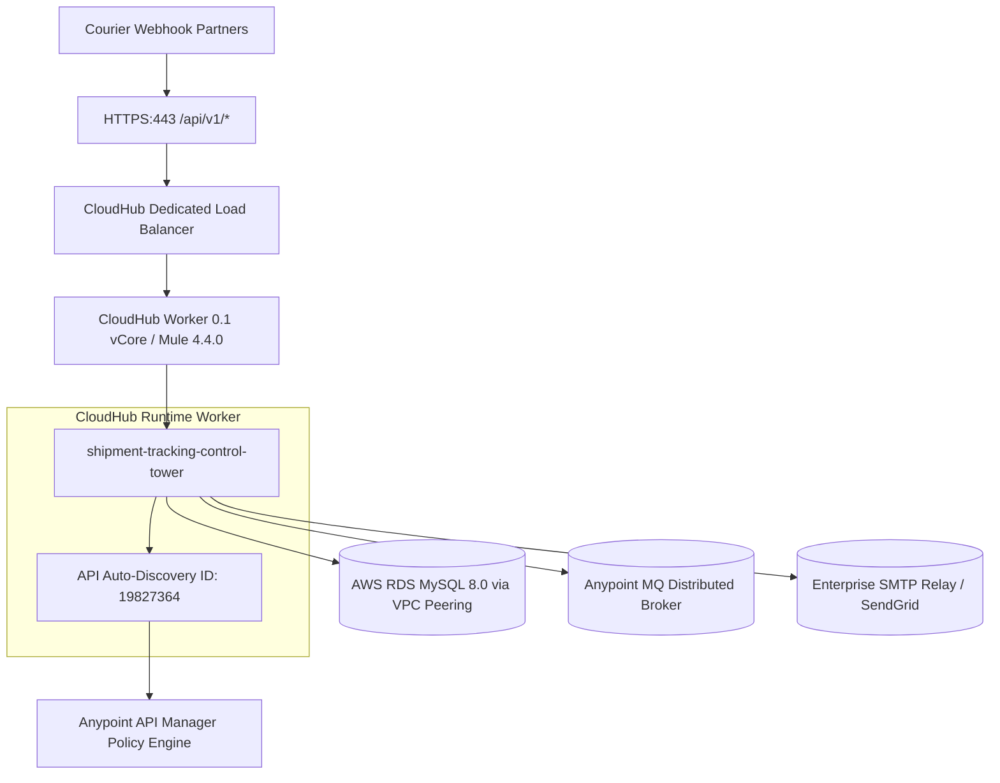

# 20 – Enterprise Deployment & API Management Runbook

**Project**: Shipment Signal Control Tower — Real-Time Multi-Carrier Shipment Tracking  
**Target Cloud Platform**: MuleSoft CloudHub 1.0 / CloudHub 2.0  
**Deployment Tool**: Mule Maven Plugin (`mule-maven-plugin:3.8.2`)  
**Status**: **IMPLEMENTED — NOT VERIFIED** (Documented as an enterprise production runbook)  

---

## 1. Build & Packaging Process

The application is packaged into a standalone Mule deployable archive using the standard Apache Maven build lifecycle.

### Command:
```bash
mvn clean package -DskipTests
```

### Packaging Execution:
1. Maven reads `pom.xml` where `<packaging>mule-application</packaging>` is defined.
2. `mule-maven-plugin` validates `mule-artifact.json` and bundles:
   - Compiled flow XML configurations (`src/main/mule/`).
   - RAML contract and schemas (`src/main/resources/api/`).
   - DataWeave mapping scripts (`src/main/resources/dw/`).
   - Environment property files (`src/main/resources/config/`).
   - Third-party JDBC drivers and connector plugins.
3. Produces the deployable artifact:
   `target/shipment-tracking-control-tower-1.0.0-SNAPSHOT-mule-application.jar`

---

## 2. CloudHub Deployment Architecture



---

## 3. Deployment Configuration in `pom.xml`

To deploy automatically to CloudHub from CI/CD pipelines (Jenkins, GitHub Actions), configure the `mule-maven-plugin` profile in `pom.xml`:

```xml
<plugin>
    <groupId>org.mule.tools.maven</groupId>
    <artifactId>mule-maven-plugin</artifactId>
    <version>3.8.2</version>
    <extensions>true</extensions>
    <configuration>
        <cloudHubDeployment>
            <uri>https://anypoint.mulesoft.com</uri>
            <muleVersion>4.4.0</muleVersion>
            <username>${anypoint.username}</username>
            <password>${anypoint.password}</password>
            <environment>Production</environment>
            <applicationName>shipment-tracking-control-tower-prod</applicationName>
            <businessGroup>Logistics-Business-Group</businessGroup>
            <workerType>MICRO</workerType>
            <workers>2</workers>
            <properties>
                <mule.env>prod</mule.env>
                <runtime.encryption.key>${env.DECRYPTION_KEY}</runtime.encryption.key>
            </properties>
        </cloudHubDeployment>
    </configuration>
</plugin>
```

### Execution Command:
```bash
mvn clean deploy -DmuleDeploy \
  -Danypoint.username="YOUR_ANYPOINT_USER" \
  -Danypoint.password="YOUR_ANYPOINT_PASSWORD" \
  -Denv.DECRYPTION_KEY="YOUR_AES_SECRET_KEY"
```

---

## 4. Anypoint API Manager & Auto-Discovery

To apply out-of-the-box governance policies without touching code, the application binds to Anypoint API Manager using **API Auto-Discovery**:

### XML Configuration in `global-config.xml`:
```xml
<api-gateway:autodiscovery 
    doc:name="API Autodiscovery" 
    apiId="${api.id}" 
    ignoreBasePath="true" 
    flowRef="shipment-tracking-main" />
```

### Recommended Production API Policies:
1. **Client ID Enforcement**: Restricts access to partners registered on Anypoint Exchange.
2. **Rate Limiting - SLA Based**: Restricts each courier to 1,000 requests per minute to prevent system overload.
3. **IP Whitelist**: Restricts webhook calls exclusively to known BlueDart and Delhivery outbound gateway IP addresses.

---

## 5. Deployment Verification & Rollback Plan

### Post-Deployment Health Check:
Immediately following a CloudHub deployment, run:
```bash
curl -X GET https://shipment-tracking-control-tower-prod.us-e1.cloudhub.io/api/v1/health
```
Verify response contains `"status": "UP"` and `"database": "CONNECTED"`.

### Rollback Procedure:
If unexpected runtime anomalies occur:
1. In **Runtime Manager**, select the application.
2. Under **Application Details**, click **Deployments History**.
3. Locate the previous stable build artifact (e.g., build `#14`).
4. Click **Apply Revision**. CloudHub performs a zero-downtime rolling restart to the previous stable build.
