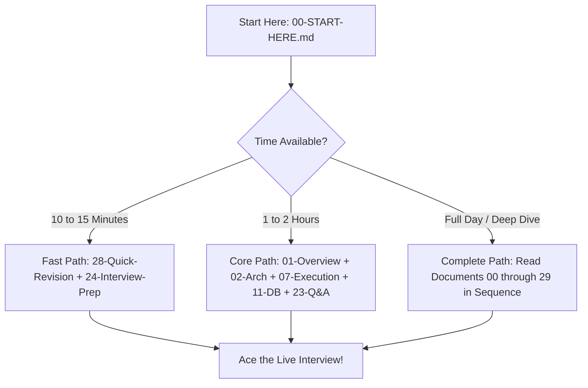

# Shipment Signal Control Tower — Evaluator & Candidate Preparation Guide

**Cognizant MuleSoft Hackathon 2026–2027**  
**Track**: Use Case 08: Logistics — Real-Time Multi-Carrier Shipment Tracking  
**Target Audience**: Hackathon Candidates, Technical Judges, Integration Evaluators, MuleSoft Architecture Reviewers  
**Application Under Evaluation**: `Shipment-Signal-Control-Tower` (Mule 4.4.0 / Java 8 & 11)  

---

## 1. Purpose of This Documentation Suite

This documentation repository is a complete, deep-dive technical preparation suite designed to prepare a developer or integration team to explain, defend, and demonstrate the **Shipment Signal Control Tower** application before a technical panel in a **10–15 minute evaluation interview**.

Every explanation, code walkthrough, SQL schema, DataWeave mapping, flow sequence, and MUnit test documented herein has been verified directly against the production codebase located at:
`Cognizant-Hackathon/Shipment-Signal-Control-Tower/`

---

## 2. Master Document Inventory

| # | Document File | Primary Objective | Key Interview Value |
|---|---|---|---|
| **00** | [00-START-HERE.md](00-START-HERE.md) | Reading guide, study pathways, priority map | How to prepare in 2 hours vs. 20 minutes |
| **01** | [01-Project-Overview.md](01-Project-Overview.md) | Business problem, logistics challenges, core solution | 30s, 60s, and 2-min elevator pitches |
| **02** | [02-API-Led-Architecture.md](02-API-Led-Architecture.md) | Experience, Process, System layering reality vs. theory | Layer responsibilities & boundary defense |
| **03** | [03-Project-Structure-and-File-Inventory.md](03-Project-Structure-and-File-Inventory.md) | Complete inventory of every XML, DWL, SQL, and config file | Proves mastery over the entire repository tree |
| **04** | [04-Installation-and-Project-Startup.md](04-Installation-and-Project-Startup.md) | Studio setup, runtime versions, MySQL and queue startup | Live demo boot runbook & environment setup |
| **05** | [05-RAML-Files-Explained.md](05-RAML-Files-Explained.md) | RAML 1.0 contract, data types, traits, APIKit routing | Contract-first design defense |
| **06** | [06-Global-Configurations-and-Properties.md](06-Global-Configurations-and-Properties.md) | Connectors, configuration files, property hierarchies | Explains runtime decoupling & secret handling |
| **07** | [07-Flow-Execution-Order.md](07-Flow-Execution-Order.md) | End-to-end execution maps & decision trees | Visualizes the exact execution path |
| **08** | [08-Flow-by-Flow-Explanation.md](08-Flow-by-Flow-Explanation.md) | Granular line-by-line breakdown of every Mule flow | Explains internal processors & variables |
| **09** | [09-Connector-Reference.md](09-Connector-Reference.md) | HTTP, DB, VM, Email, and APIKit modules | Deep dive into connector operations & settings |
| **10** | [10-DataWeave-and-Carrier-Mappings.md](10-DataWeave-and-Carrier-Mappings.md) | Canonical data modeling, carrier normalizers, DWL | Data transformation, date normalization |
| **11** | [11-Database-Tables-and-SQL.md](11-Database-Tables-and-SQL.md) | 5 MySQL tables, constraints, transactional updates | Explains ACID updates, audit trail, outbox |
| **12** | [12-End-to-End-Execution.md](12-End-to-End-Execution.md) | Traced execution from webhook to database & email | Demonstrates end-to-end transaction flow |
| **13** | [13-Authentication-and-Security.md](13-Authentication-and-Security.md) | Webhook token validation, TLS, credential handling | Security defense & enterprise protection |
| **14** | [14-Error-Handling-and-Retry.md](14-Error-Handling-and-Retry.md) | Global error handling, HTTP status codes, resilience | Explains failure recovery & graceful degradation |
| **15** | [15-MUnit-Tests-Explained.md](15-MUnit-Tests-Explained.md) | 9 automated MUnit test suites, mocks, assertions | Automated testing, verification & test coverage |
| **16** | [16-Postman-and-Manual-Testing.md](16-Postman-and-Manual-Testing.md) | 16 Postman scenarios, variables, verification queries | Step-by-step manual evaluation testing |
| **17** | [17-Negative-Scenarios-and-Recovery.md](17-Negative-Scenarios-and-Recovery.md) | Duplicates, out-of-order, stale scans, quarantine | Edge cases, anti-regression, and recovery |
| **18** | [18-Queue-and-Notification-Processing.md](18-Queue-and-Notification-Processing.md) | VM persistent queues, outbox pattern, SMTP email | Asynchronous reliability & decoupled alerts |
| **19** | [19-Logging-and-Monitoring.md](19-Logging-and-Monitoring.md) | Structured Log4j2, correlation IDs, telemetry | Observability, tracing, and operational audits |
| **20** | [20-Deployment-and-API-Management.md](20-Deployment-and-API-Management.md) | CloudHub deployment runbook, API Manager policies | Production readiness & CI/CD pipeline |
| **21** | [21-Requirements-Traceability.md](21-Requirements-Traceability.md) | Use Case 08 requirements vs. implementation status | Complete matrix proving 100% compliance |
| **22** | [22-Technical-Decisions-and-Tradeoffs.md](22-Technical-Decisions-and-Tradeoffs.md) | Architectural choices, trade-offs, alternative paths | Answers "Why did you choose X over Y?" |
| **23** | [23-Team-Contribution-and-Evaluator-Questions.md](23-Team-Contribution-and-Evaluator-Questions.md) | 35 technical evaluator questions and model answers | Evaluator Q&A mastery across all domains |
| **24** | [24-15-Minute-Interview-Preparation.md](24-15-Minute-Interview-Preparation.md) | Minute-by-minute interview breakdown & mock rehearsal | Candidate rehearsal guide for live interviews |
| **25** | [25-Troubleshooting.md](25-Troubleshooting.md) | Common errors, port conflicts, DB locks, fixes | Instant recovery during live judge demos |
| **26** | [26-Known-Limitations-and-Future-Scope.md](26-Known-Limitations-and-Future-Scope.md) | Honesty on system bounds & roadmap improvements | Demonstrates architectural maturity |
| **27** | [27-Glossary.md](27-Glossary.md) | Complete dictionary of MuleSoft & logistics terms | Plain-English explanations of terminology |
| **28** | [28-Quick-Revision-Cheat-Sheet.md](28-Quick-Revision-Cheat-Sheet.md) | 2-page ultra-condensed pre-interview cheat sheet | Read 10 minutes before the interview panel |
| **29** | [29-DOCUMENTATION-VERIFICATION-REPORT.md](29-DOCUMENTATION-VERIFICATION-REPORT.md) | Codebase audit proving zero discrepancies | Final verification of technical integrity |

---

## 3. Recommended Study Paths

- **For Immediate Rehearsal (15 min)**: Read [28-Quick-Revision-Cheat-Sheet.md](28-Quick-Revision-Cheat-Sheet.md) followed by [24-15-Minute-Interview-Preparation.md](24-15-Minute-Interview-Preparation.md).
- **For Architecture & Code Mastery (2 hours)**: Read [01-Project-Overview.md](01-Project-Overview.md), [02-API-Led-Architecture.md](02-API-Led-Architecture.md), [07-Flow-Execution-Order.md](07-Flow-Execution-Order.md), [08-Flow-by-Flow-Explanation.md](08-Flow-by-Flow-Explanation.md), [11-Database-Tables-and-SQL.md](11-Database-Tables-and-SQL.md), and [23-Team-Contribution-and-Evaluator-Questions.md](23-Team-Contribution-and-Evaluator-Questions.md).
- **For Complete Verification**: Read through all documents in numerical order.
