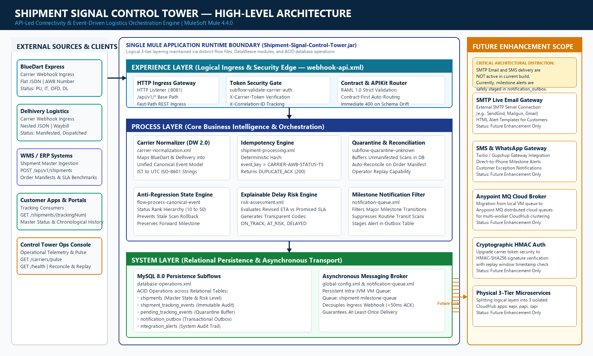

# Shipment Signal Control Tower
## Real-Time Multi-Carrier Shipment Tracking Integration Platform

[](https://www.mulesoft.com/)
[](https://docs.mulesoft.com/dataweave/latest/)
[](https://raml.org/)
[](https://www.mysql.com/)
[](https://docs.mulesoft.com/munit/latest/)

**Cognizant MuleSoft Hackathon**  
**Track**: Use Case 08: Logistics — Real-Time Multi-Carrier Shipment Tracking  
**Application**: `Shipment-Signal-Control-Tower`

---

## 1. Executive Summary

Modern e-commerce and third-party logistics (3PL) enterprises depend on multiple courier networks (such as **BlueDart Express** for aviation air-cargo networks and **Delhivery Logistics** for ground surface freight). Disparate carrier webhook feeds present severe technical challenges:
- **Heterogeneous Schemas**: Flat JSON (BlueDart) vs deeply nested objects and arrays (Delhivery).
- **Status & Timezone Inconsistencies**: Varied lifecycle codes (`PU`, `IT`, `OFD`, `Van Out`, `Manifested`) and datetime formats (IST with offsets vs space-delimited text).
- **Duplicate Deliveries**: Cellular drops triggering 3–5 identical webhook retries.
- **Out-of-Order Scans**: Delayed uploads from rural hubs or vans rolling back master states (e.g. reverting `DELIVERED` to `IN_TRANSIT`).
- **Unmanifested Scans ("Ghost Shipments")**: Courier scanning packages before WMS batch manifests finish synchronizing.
- **Notification Noise & Blind Delays**: Spamming customers with routine linehaul hops while missing proactive delivery SLA breach alerts.

The **Shipment Signal Control Tower** is an enterprise-grade integration control tower built natively on **MuleSoft Mule 4.4**. It unifies multi-carrier tracking feeds into a standard 9-milestone Canonical Event Model, provides deterministic deduplication, enforces forward-only lifecycle progression, buffers unmanifested parcels with automated reconciliation, and calculates explainable SLA delay risks.

---

## 2. High-Level Architecture



### Logical 3-Tier Layering (API-Led Connectivity)
1. **Experience Layer** (`webhook-api.xml`):
   - Secure HTTP Ingress endpoints (`/api/v1/webhooks/carriers/{carrierCode}`, `/webhooks/bluedart`, `/webhooks/delhivery`, `/shipments`, `/health`, `/carriers/pulse`).
   - Carrier Security Gate (`subflow-validate-carrier-auth`) checking `X-Carrier-Token` and attaching `X-Correlation-ID`.
   - Contract validation via RAML 1.0 APIKit Router.
2. **Process Layer** (`carrier-normalization.xml`, `shipment-processing.xml`, `risk-assessment.xml`, `notification-queue.xml`):
   - DataWeave 2.0 Canonical Data Model (CDM) Normalization.
   - Idempotency & Deduplication Engine (`event_key = CARRIER-AWB-STATUS-TIMESTAMP`).
   - Unmanifested Shipment Quarantine Buffer (`pending_tracking_events`) & Batch Reconciler (`/events/reconcile`).
   - Anti-Regression State Machine preventing master state rollbacks (Status Rank hierarchy 10–50).
   - Explainable SLA Delay Risk Engine (`ON_TRACK`, `AT_RISK`, `DELAYED`).
   - Milestone Notification Filter & Transactional Outbox Staging.
3. **System Layer** (`database-operations.xml`, `notification-queue.xml`):
   - MySQL 8.0 ACID Relational Persistence (`shipments`, `shipment_tracking_events`, `pending_tracking_events`, `notification_outbox`, `integration_alerts`).
   - Asynchronous Persistent VM Queue (`shipment-milestone-queue`) providing sub-50ms webhook acknowledgment.

> **Note on Notification Delivery**: In the current implementation, milestone alerts are safely staged in the relational `notification_outbox` table, and the asynchronous VM queue decouples background consumer processing without sending live external emails. External SMTP email and live SMS dispatch are designated as future roadmap scope.

---

## 3. Repository Structure

```text
├── Cognizant-Hackathon/
│   ├── Shipment-Signal-Control-Tower/         # Core Mule 4 Anypoint Studio Application
│   │   ├── pom.xml                            # Maven project configuration & Exchange repo
│   │   ├── mule-artifact.json                 # Mule runtime configuration & secure properties
│   │   ├── src/main/mule/                     # Modular Mule XML Flows (Logical 3-Tier)
│   │   │   ├── webhook-api.xml                # Experience Layer: HTTP Ingress & APIKit Routing
│   │   │   ├── carrier-normalization.xml      # Process Layer: Normalization Subflows
│   │   │   ├── shipment-processing.xml        # Process Layer: Deduplication & State Machine
│   │   │   ├── risk-assessment.xml            # Process Layer: Explainable Delay Risk Engine
│   │   │   ├── notification-queue.xml         # Process/System: Outbox & VM Queue Consumer
│   │   │   ├── database-operations.xml        # System Layer: MySQL CRUD Operations
│   │   │   ├── error-handling.xml             # Global Error Handler & Response Mapping
│   │   │   └── global-config.xml              # Global Connectors & API Autodiscovery
│   │   ├── src/main/resources/
│   │   │   ├── api/shipment-tracking.raml     # RAML 1.0 REST API Contract
│   │   │   ├── dw/                            # DataWeave 2.0 Mapping Scripts
│   │   │   │   ├── bluedart-to-canonical.dwl  # BlueDart flat JSON to Canonical CDM
│   │   │   │   └── delhivery-to-canonical.dwl # Delhivery nested JSON to Canonical CDM
│   │   │   ├── config/                        # Environment properties (mule-dev.yaml, mule-prod.yaml)
│   │   │   └── examples/                      # Verified sample JSON payloads
│   │   ├── src/test/munit/                    # 19 MUnit Unit & Integration Tests (100% Pass)
│   │   ├── database/                          # MySQL DDL Schemas & Seed Sample Data
│   │   └── postman/                           # Complete Postman Collection & Environments
│   │
│   ├── Shipment-Tracking-Complete-Guide/      # 21 In-Depth Technical Guides (Architecture, Flows, DB)
│   ├── Shipment-Tracking-Evaluator-Guide/     # 31 Evaluator Preparation Guides & Q&A
│   ├── Shipment_Signal_Control_Tower_Hackathon_Writeup.docx # Official Hackathon Submission Writeup (Word)
│   ├── Shipment_Signal_Control_Tower_Hackathon_Writeup.pdf  # Official Matching 12-Page Submission PDF
│   └── architecture_diagram.png               # High-Resolution Architecture Diagram (300 DPI)
├── .gitignore                                 # Git Ignore Rules
└── README.md                                  # Project Overview & Quick Start
```

---

## 4. API Specifications & Endpoints

Base URI: `http://localhost:8081/api/v1`  
Interactive Console: `http://localhost:8081/console/`

| HTTP Method | Endpoint Path | Layer | Purpose | Status |
|:---:|---|:---:|---|:---:|
| `POST` | `/webhooks/carriers/{carrierCode}` | Experience | Multi-Carrier Ingestion Gateway (BlueDart / Delhivery) | Verified |
| `POST` | `/webhooks/bluedart` | Experience | Dedicated BlueDart Express Ingress Route | Verified |
| `POST` | `/webhooks/delhivery` | Experience | Dedicated Delhivery Logistics Ingress Route | Verified |
| `POST` | `/shipments` | Exp / Sys | WMS Order Manifest Ingestion (`201 Created`) | Verified |
| `GET` | `/shipments/{trackingNumber}` | Exp / Sys | Current Master Status, SLA Benchmark & Delay Risk | Verified |
| `GET` | `/shipments/{trackingNumber}/history` | Exp / Sys | Full Chronological Immutable Audit Event Trail | Verified |
| `GET` | `/shipments/{trackingNumber}/risk` | Exp / Proc | Explainable SLA Delay Risk Calculation | Verified |
| `GET` | `/shipments/{trackingNumber}/notifications` | Exp / Sys | Dispatched Milestone Alert Records from Outbox | Verified |
| `GET` | `/health` | Exp / Sys | System Health Check (Database & VM Queue Broker) | Verified |
| `GET` | `/carriers/pulse` | Exp / Proc | Aggregated Carrier Telemetry & Volume Anomaly Metrics | Verified |
| `POST` | `/events/replay` | Exp / Proc | Operator Manual Replay of Quarantined Events | Verified |
| `POST` | `/events/reconcile` | Exp / Proc | Batch Auto-Reconciliation of Quarantined Scans | Verified |

---

## 5. Canonical Status Conversion Dictionary

| Canonical Status | Rank | BlueDart Code | Delhivery Status | Lifecycle Meaning |
|---|:---:|---|---|---|
| `LABEL_CREATED` | 10 | `LC`, `BK` | `MANIFESTED`, `MF`, `SOFTDATA` | Label manifested |
| `PICKED_UP` | 20 | `PU` | `PENDING`, `PP`, `PICKED UP` | Physical custody accepted; alert staged |
| `IN_TRANSIT` | 30 | `IT`, `DP` | `IN TRANSIT`, `IT` | Movement between transit hubs; suppressed |
| `ARRIVED_AT_HUB` | 35 | `AR`, `HUB` | `BAG IN`, `ARRIVED AT FACILITY` | Sorting facility scan |
| `OUT_FOR_DELIVERY`| 40 | `OFD`, `OD` | `OUT FOR DELIVERY`, `VAN OUT` | On delivery vehicle; alert staged |
| `DELIVERY_ATTEMPTED`| 45 | `UD`, `NA` | `UNDELIVERED`, `DELIVERY ATTEMPTED` | Recipient unavailable; alert staged |
| `DELIVERED` | 50 | `DL`, `OK` | `DELIVERED`, `DL` | Confirmed handover; terminal state |
| `RETURNED` | 90 | `RT`, `RTO` | `RTO`, `RETURN TO ORIGIN` | Returned to shipper |
| `EXCEPTION` | 95 | `EX`, `HLD`, `DMG` | `EXCEPTION`, `DAMAGED`, `LOST` | Operational incident; exception alert |
| `UNKNOWN_STATUS` | 0 | Unmapped | Unmapped | Safe fallback logging audit alert |

---

## 6. How to Run & Test

### Prerequisites
- **JDK 17** (Temurin 17 recommended)
- **Anypoint Studio 7.15+** or **Apache Maven 3.9+**
- **MySQL 8.0** running locally on port `3306` with schema `shipment_control_tower`

### Database Setup
Execute the SQL initialization scripts located in `Cognizant-Hackathon/Shipment-Signal-Control-Tower/database/`:
```bash
mysql -u root -p < Cognizant-Hackathon/Shipment-Signal-Control-Tower/database/schema.sql
mysql -u root -p < Cognizant-Hackathon/Shipment-Signal-Control-Tower/database/sample-data.sql
```

### Running Tests (MUnit)
```bash
cd Cognizant-Hackathon/Shipment-Signal-Control-Tower
mvn clean test
```
*Result: 19/19 Tests Passing with 0 Errors, 0 Failures.*

### Running Application Locally
In Anypoint Studio: Right-click project $\rightarrow$ **Run As** $\rightarrow$ **Mule Application**.  
Via Maven:
```bash
mvn clean package -DskipTests
```
The API is accessible at `http://localhost:8081/api/v1` and the APIKit interactive console at `http://localhost:8081/console/`.

---

## 7. Submission Deliverables

- **Official Submission Write-up (Word)**: [`Shipment_Signal_Control_Tower_Hackathon_Writeup.docx`](Cognizant-Hackathon/Shipment_Signal_Control_Tower_Hackathon_Writeup.docx)
- **Official Submission Write-up (PDF)**: [`Shipment_Signal_Control_Tower_Hackathon_Writeup.pdf`](Cognizant-Hackathon/Shipment_Signal_Control_Tower_Hackathon_Writeup.pdf)
- **Evaluator Preparation Guide**: [`Cognizant-Hackathon/Shipment-Tracking-Evaluator-Guide/`](Cognizant-Hackathon/Shipment-Tracking-Evaluator-Guide/)
- **Complete Technical Guide**: [`Cognizant-Hackathon/Shipment-Tracking-Complete-Guide/`](Cognizant-Hackathon/Shipment-Tracking-Complete-Guide/)
- **Postman Test Suite**: [`Cognizant-Hackathon/Shipment-Signal-Control-Tower/postman/`](Cognizant-Hackathon/Shipment-Signal-Control-Tower/postman/)
